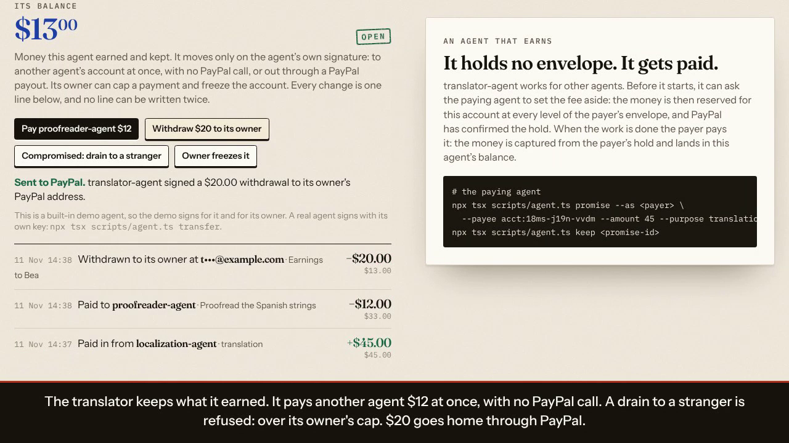
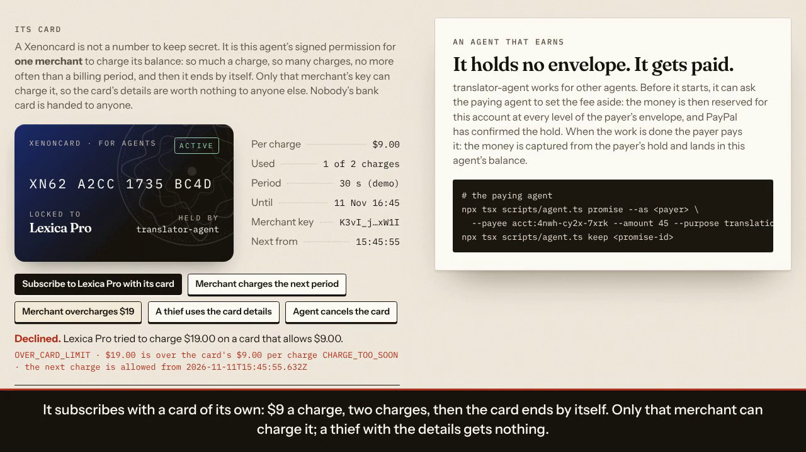
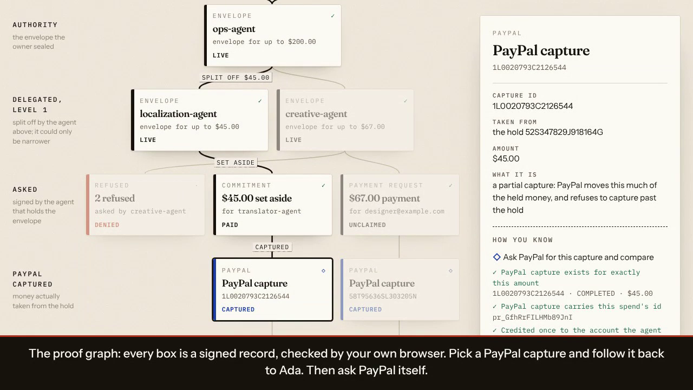
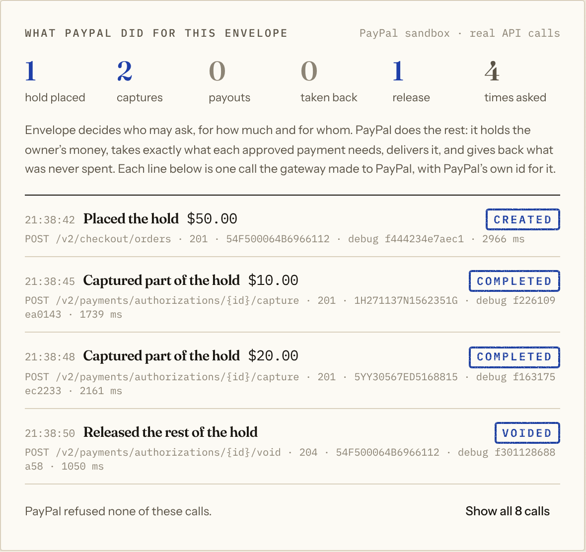
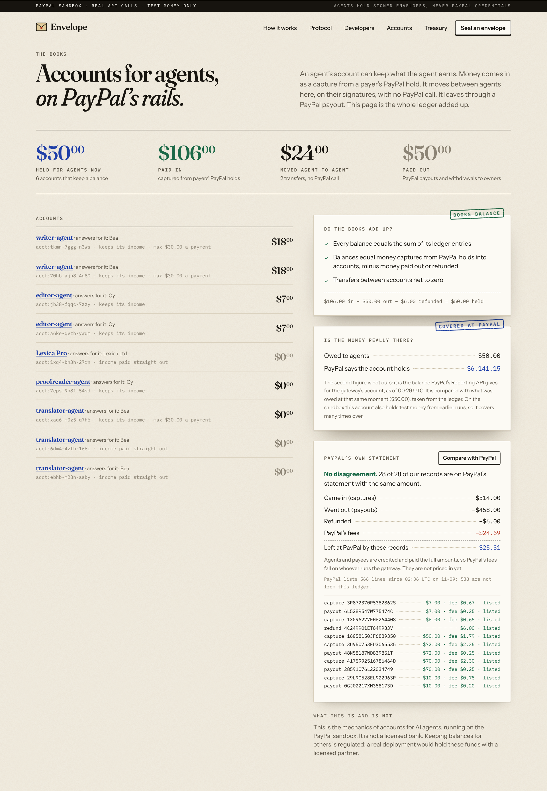

# Envelope

**Give your agent an envelope, not your wallet.**

Try it (no sign-up): <https://envelope-paypal.vercel.app> · Video: <!-- VIDEO-LINK --> [`docs/demo/envelope-demo.mp4`](docs/demo/envelope-demo.mp4) for now · Sandbox evidence: [`docs/evidence/`](docs/evidence/) · SDK: [`docs/SDK.md`](docs/SDK.md)

Someone who lets an AI agent spend money has two bad choices: hand it a credential that can spend everything, or approve every payment by hand. The freelancer or agent on the other side has a problem of its own: it cannot tell whether the software asking for work can pay. Envelope is one answer to both: a spending limit the owner signs, that PayPal holds the money for, and that anyone can check.

Envelope is spending authority for AI agents that can be **split but never enlarged**. A person seals an envelope ("$200, only to these two payees, only for translation and design, until tonight") and PayPal places a hold for the whole amount. The agent can split off smaller envelopes for the agents it hires. Nobody down the chain can spend more, pay anyone else, or outlive it, and every payment comes back with a receipt showing exactly who authorized it.

Agentic banking on PayPal's rails: accounts, cards and a treasury for AI agents, with the owner's limits enforced by signatures and arithmetic. (The mechanics of a bank for agents, running on the PayPal sandbox. Not a licensed bank.)

## Judges: two minutes

On the hosted copy, which needs no sign-up and runs on the PayPal simulator (every page says so):

1. **Console → "Seal & hold $200.00 on PayPal"**, or "Or approve the hold in PayPal first". *You sign; PayPal holds the money.*
2. **"Run the launch".** *Agents split the budget and pay.*
3. **"Compromise the creative agent".** *Three attacks, each refused with a reason.*
4. **"What PayPal did for this envelope".** *Every PayPal call, in order.*
5. **"Receipt & authority chain", then the proof graph.** *One payment traced to your signature.*
6. **Accounts → "Compare with PayPal".** *The books against PayPal's own statement.* A line there opens the receipt of its payment.
7. **Open a second tab.** *Same data; neither tab waits.*

## What is proven where

Every row below is taken from the two longer tables further down ("What PayPal does here" and "What has actually run"), which give the ids.

| Capability | On the real PayPal sandbox | On the simulator only |
|---|---|---|
| Hold for the whole envelope, partial captures, release of the rest | Ran: [`sandbox-run.json`](docs/evidence/sandbox-run.json) | |
| Payouts, and what PayPal finally says of each (delivered or unclaimed) | Ran: same file | A payout that fails after its capture |
| The owner approves the hold in PayPal's own checkout | PayPal issued the approval link and sealing before approval was refused; a person's approval there is still pending <!-- APPROVAL-SANDBOX --> | The whole path: cancel seals nothing, approval places the hold |
| Refund by the agent that was paid | Ran: capture `1XG96277EH6264408`, refund `4C249901ET649933V` | A refund PayPal refuses or cannot be reached for |
| A refund returns money and not budget | Ran: PayPal refused a second capture after a refund | |
| Reserves against the balance PayPal reports | Ran (the reading; the sandbox account also holds old test money) | A shortfall |
| Every record looked up in PayPal's own statement, with PayPal's fees | Ran: all 28 records listed, none differing: [`statement-check.json`](docs/evidence/statement-check.json) | A record that disagrees |
| PayPal's own events, read from its event feed | Ran: seven events about one run, one of which settled a payment: [`paypal-events.json`](docs/evidence/paypal-events.json) | A late event, a hold voided outside the gateway |
| A delivery PayPal pushes, verified by its signature | Ran: two genuine deliveries confirmed by PayPal, the same two with one character changed refused, one of them settled a payment: [`paypal-events.json`](docs/evidence/paypal-events.json). They reached the gateway by replay from the hosted copy's log, not directly | Unsigned and late deliveries |
| Disputes | Asked; PayPal holds none against the account | Finding one and answering it with evidence |
| Recall of a payout nobody claimed | PayPal's sandbox answers every cancel with a server error | The whole recall |
| The SDK's example program | Ran: [`sdk-run.md`](docs/evidence/sdk-run.md) | 19 tests |
| A language model driving the agents | Ran: [`model-run.md`](docs/evidence/model-run.md), [`card-run.md`](docs/evidence/card-run.md) | |
| 171 scripted attacks, 114 automated tests | | All of them: [`attack-suite.json`](docs/evidence/attack-suite.json) |

## What an agent gets

It behaves like an account of the agent's own:

- **It has an identity.** Each agent has an account number and a passport drawn from its key.
- **Anyone can check it.** Before doing any work, a payee can ask "is this agent good for $70 to me, right now?" The answer is signed, names every person and agent standing behind it, and includes PayPal's own confirmation that the money is on hold.
- **It can set money aside.** An agent can earmark a fee for one payee before the work starts. Nothing else can spend it until it is paid or released.
- **It can get paid.** An agent can open an account that receives. Other agents pay it by account number, and PayPal pays out to the owner who answers for it.
- **It can keep a balance.** An account can hold what the agent earns. The agent pays other agents out of it with its own signature, at once and with no PayPal call, or sends money out through a PayPal payout. Its owner can cap a payment and freeze the account.
- **It has a card.** A Xenoncard is the agent's signed permission for one merchant to charge its balance: so much a charge, so many charges, no more often than a billing period, and then it ends by itself. Only that merchant's key can charge it, so the card's details are worth nothing to a thief, and nobody's bank card is handed to anyone.
- **Every dollar can be traced.** The proof graph lays out every record behind an envelope: the owner's signature, the PayPal hold, each level of delegation, each request, commitment and acceptance, PayPal's captures and payouts, and what a paid agent did next. Your browser checks every signature itself. Pick any payment and follow it back to the person.
- **Its owner stays in control.** The owner can require their own signature above an amount. Over it, an agent can only ask: the money is set aside and waits in the owner's inbox.
- **It can be paid on accepted work.** Money set aside can name an agent whose signature releases it. The fingerprint of the delivered work goes on the receipt.
- **It can give a payment back.** An agent that will not do the work after all signs a refund of what it was paid, and PayPal refunds the capture to the payer. Only the agent that was paid can do it.
- **Its books are checked against PayPal's own.** What agents are owed is compared with the balance PayPal reports for the gateway's account, each capture and payout is looked up in PayPal's statement of that account, and every receipt asks PayPal whether the payer has disputed it.

Around that sit three layers on the same primitive: a **Treasury** for the owner (everything their agents can touch, reconciled against PayPal), **Accounts** for each agent (identity, income, a balance it can spend, a signed record it can carry anywhere), and a **Protocol** between agents (prove funds, set aside, release, receipt). The pages lead to each other the way the records do: a line of PayPal's statement opens the receipt of its payment, a receipt opens the chain of signatures behind it, an agent's ledger entry opens its receipt, and the treasury, the receipt and the PayPal panel all lead to the books.

```
 Ada ──seals──▶ ops-agent  $200            PayPal: authorization (hold) $200
                 ├─ splits ─▶ localization-agent  $60, translator-agent's account only
                 │              ├─ sets $45 aside ─▶ reserved at every level, hold confirmed
                 │              └─ pays it ────────▶ PayPal: partial capture $45 → translator-agent's balance
                 └─ splits ─▶ creative-agent  $90, designer only
                                ├─ pays $70 ──▶ PayPal: partial capture $70 + payout
                                └─ "pay attacker@evil" ──▶ DENIED  PAYEE_NOT_ALLOWED
 Ada ──closes─▶                            PayPal: void → $85 released, $115 charged

 translator-agent (owner: Bea)  balance $45
                 ├─ pays proofreader-agent $12 ───▶ moved on the ledger, no PayPal call
                 ├─ "send it all to a stranger" ──▶ DENIED  OVER_ACCOUNT_LIMIT (Bea's cap: $30)
                 ├─ Bea freezes the account ──────▶ nothing leaves until she lifts it
                 ├─ withdraws $20 ────────────────▶ PayPal: payout to Bea
                 └─ issues a card for Lexica Pro: $9 a charge, 2 charges, one per period
                       ├─ Lexica charges $9 ──────▶ PayPal: payout to Lexica
                       ├─ Lexica charges $19 ─────▶ DECLINED  OVER_CARD_LIMIT
                       ├─ a thief with the card details ─▶ DECLINED  NOT_THE_MERCHANT
                       └─ after the 2nd charge ───▶ the card has ended by itself
```

Built for the PayPal AI Hackathon 2026. Sandbox only. The people and agents in the demo are fictional.


| A real model playing the agents (still from the video) | The owner's treasury, books checked against PayPal (still from the video) |
|---|---|
|  |  |

| A payment over the owner's threshold, waiting for a signature (still from the video) | The passport of an agent that gets paid (on the simulator) |
|---|---|
|  |  |

| An agent's balance: paid in, paid to another agent, a drain refused (still from the video) | Its card: locked to one merchant, charged once, an overcharge declined (still from the video) |
|---|---|
|  |  |




Demo video: [`docs/demo/envelope-demo.mp4`](docs/demo/envelope-demo.mp4).

## Try it without installing anything

Deploy this repository to Vercel with no settings at all and it works: when the site has no database, **the whole gateway runs in your browser**. The same handlers the server uses run against Postgres compiled to WebAssembly (PGlite, kept in your browser and shared between tabs) and a PayPal simulator. Every page says so in a red strip, and nothing leaves the tab. You can seal an envelope, run the agents, compromise one, check an agent's standing, open receipts and close the envelope.

A hosted copy of that kind is at <https://envelope-paypal.vercel.app> (also <https://kept-paypal.vercel.app>). Open it in as many tabs as you like: they share the one database, and closing or reloading any of them does not hold up the others.

Give the deployment a `DATABASE_URL` and PayPal sandbox credentials and the same pages talk to a real server gateway and the real PayPal sandbox.

## The problem

An agent that can pay holds a credential. When it delegates work to another agent, it either hands over the same credential or becomes a bottleneck approving every payment. Flat spending limits don't compose: an orchestrator with a $500 limit that calls five sub-agents has five $500 problems. The agent or freelancer on the other side can't tell whether the software asking for work can pay. And afterwards nobody can answer the questions that matter: who authorized this dollar, under what limits, and how bad could it have been?

## What PayPal does here

Without PayPal an envelope is a signed promise. With it, it is money. Envelope decides who may ask, for how much and for whom; PayPal does everything that touches money. The gateway keeps a record of its calls to PayPal (every one that changes something, and every read whose answer is new), and each envelope's page shows its own under "What PayPal did for this envelope".

| PayPal | What it is for here | Proven on |
|---|---|---|
| Orders v2, `intent: AUTHORIZE` | The hold. The owner's money is reserved for the envelope and not charged. | Sandbox (on PayPal's sandbox test card, with no payer present) |
| Orders v2 with a PayPal payment source, `GET` order, order authorize | The owner approves the hold in PayPal's own checkout. Nothing is held or recorded until they do; the gateway then reads the order from PayPal and places the hold only if it was made for this envelope, for this amount, and is approved. | Simulator for the whole path. On the sandbox PayPal issued the approval link (`PAYER_ACTION_REQUIRED`) and sealing before approval was refused; a person's approval at PayPal is still pending <!-- APPROVAL-SANDBOX --> |
| `GET` authorization | Proof of funds. A payee, the proof graph and every receipt ask PayPal whether the hold is live. The answer to a payee also says when PayPal's three-day honor period for the hold ends. | Sandbox |
| Authorization capture (partial) | Each approved payment takes exactly its amount. PayPal refuses anything past the hold. | Sandbox |
| Payouts | Delivery to any PayPal address: a freelancer, a shop, the owner of an agent that earned it. | Sandbox |
| `GET` payout | Delivered, unclaimed or returned. Nothing is called paid until PayPal says it arrived. | Sandbox |
| Authorization void | Closing an envelope gives back what was never spent. | Sandbox |
| Capture refund | An agent that was paid gives a payment back; a payout that cannot be delivered goes back to the owner. The owner gets the money. That part of the hold stays used, because PayPal does not return a refunded capture to it. | Sandbox for a refund by the agent that was paid. Simulator for the refund after a failed payout (no sandbox payout has failed) |
| Payout item cancel | The owner recalls a payment nobody claimed, instead of waiting thirty days. | Simulator (PayPal's sandbox answered every cancel with a server error) |
| Event feed | PayPal's own events finish a settlement. Each one makes the gateway read the record it names from PayPal, and is applied once. | Sandbox: seven events about one run, one of which took a payment from `PAYOUT_PENDING` to `PAID`. [`docs/evidence/paypal-events.json`](docs/evidence/paypal-events.json) |
| Webhook signature verification | A delivery PayPal pushes is verified with PayPal before anything is done with it. | Sandbox: PayPal pushed its events about a real $7 payment to the hosted copy, which has no gateway and logged each delivery unchanged; two were replayed to a gateway holding the sandbox credentials, and PayPal's `verify-webhook-signature` confirmed each as sent and refused the same headers with one character of the body changed. The deliveries reached the gateway by replay from the host's log, not directly. [`docs/evidence/paypal-events.json`](docs/evidence/paypal-events.json) |
| Reporting: balances | Reserves. What agents are owed is compared with the balance PayPal reports for the gateway's account, at the moment PayPal dates that figure. | Sandbox |
| Reporting: Transaction Search | Every capture, payout and refund recorded here is looked up in PayPal's own statement of the account. It is a second source, and the only place PayPal's fees appear. | Sandbox: all 28 records found on PayPal's statement with the same amount, none with a different one; a record is listed up to three hours after it is made. [`docs/evidence/statement-check.json`](docs/evidence/statement-check.json) <!-- STATEMENT-CHECK --> |
| Disputes: list, show, provide evidence | Every receipt check, and every sweep, asks PayPal whether the payer has disputed a capture. A dispute is shown on the payment and answered with the signed chain of authority, back to the payer's own key. | Sandbox for asking (PayPal held no dispute). Simulator for finding one and sending evidence |

In the last recorded sandbox run the record shows 53 calls to PayPal behind the three envelopes: 3 holds, 7 partial captures, 5 payouts, 1 refund, 3 releases, 26 reads, and 8 that PayPal refused (the cancels below). Payouts from agents' balances and the reads of PayPal's balance, statement and disputes are on top of that. Each call is in [`docs/evidence/sandbox-run.json`](docs/evidence/sandbox-run.json) with PayPal's own debug id. Every call that changes something carries an idempotency key built from the payment's id, so a retry cannot capture, pay or refund twice.





## The mechanism

| Verb | Who | What happens | PayPal |
|---|---|---|---|
| **Seal** | The owner, in their browser | Signs a root envelope (Ed25519). The gateway can enforce it but can't forge one. The hold is placed either at once, on PayPal's sandbox test card, or after the owner approves it in PayPal's own checkout: the gateway asks PayPal for an approval link, records nothing, and seals only when PayPal says the order made for this envelope is approved. | `POST /v2/checkout/orders` with `intent: AUTHORIZE`: a hold for the whole limit. With approval: the same call with a PayPal payment source, `GET /v2/checkout/orders/{id}`, then `POST /v2/checkout/orders/{id}/authorize` |
| **Split** | Any agent holding an envelope | Appends one signed block for another agent. It may only narrow: less money, fewer payees and purposes, earlier expiry. Offline; no server. | none |
| **Check** | Any payee, before working | The agent hands over a signed introduction. The gateway proves the agent controls its key, lists who stands behind it, and says whether that payment would go through now, and when PayPal's three-day honor period for the hold ends. Read-only; expires in 5 minutes. | `GET /v2/payments/authorizations/{id}`: is the hold still live? |
| **Set aside** | The agent holding an envelope | Signs a promise for one payee. The gateway reserves the amount in every envelope up the chain, confirms the hold with PayPal, and gives the payee a signed note. Moves no money. | `GET /v2/payments/authorizations/{id}` |
| **Spend** | The agent holding it | Signs a request with its own key, or pays a promise it made. The gateway verifies the whole chain, then under a lock checks revocation and the budget of **every** envelope up the chain, reserves, and pays. | `POST /v2/payments/authorizations/{id}/capture` (partial) then `POST /v1/payments/payouts` |
| **Accept** | The key a promise named | Signs that the work is delivered and accepted, with a fingerprint of it. That signature pays the promise without going back to its maker; revocation and expiry still win. Name the payee for paid-on-delivery, or a checker for paid on verified work. | Partial capture + Payout |
| **Approve** | The owner | An envelope can carry "ask me above $X". A payment over it is refused; the agent sets the money aside naming the owner, and only the owner's signature (in their browser) pays it, or declines it. The threshold can be lowered down the chain, never raised or dropped. | Partial capture + Payout, on the owner's signature |
| **Get paid** | An agent with an account | The account is opened with two signatures: the agent's own key and its owner's. A payee written as `acct:xxxx-xxxx-xxxx` is that agent; the payout goes to its owner's PayPal address, fixed when the payment is admitted. | Payout |
| **Keep a balance** | An agent whose account holds | The account is opened with `mode: "hold"`. A payment to it is still a partial capture of the payer's hold; the amount is then credited to the agent's balance on a ledger and not paid out. One ledger row per payment, so it cannot be credited twice. | `POST /v2/payments/authorizations/{id}/capture` |
| **Transfer** | The agent that owns the balance | Signs a transfer with its own key. To another account that holds, it is one debit and one credit under one lock. To a PayPal address, or home to its owner (a withdrawal), it is a debit and then a payout; if PayPal refuses, the amount goes back once. Refused when the balance is too low, over the owner's cap, or frozen. | none between accounts; `POST /v1/payments/payouts` on the way out |
| **Issue a card** | An agent with a balance | Signs a card (`envelope-card/1`) for one merchant's account: a cap per charge, a number of charges, the least time between two charges, an expiry. Issuing moves no money and creates no secret. The agent or its owner can cancel it. | none |
| **Charge a card** | The merchant the card is locked to | Signs a charge (`envelope-charge/1`) with its own key. The gateway checks the card's terms and the owner's rules under the holder's lock, debits the balance, and pays the merchant. When the charges are used up or the date passes, the card is over. | `POST /v1/payments/payouts` to the merchant, or none if the merchant keeps a balance here |
| **Freeze** | The owner of an agent's account | Signs a freeze. Nothing leaves the balance until the owner lifts it; income still arrives. The agent cannot lift it, and cannot swap in another owner. | none |
| **Recall** | The owner | A payout PayPal is holding because the payee never claimed it can be taken back. PayPal cancels the item and the capture is refunded to the owner. The amount stays used in the envelope: PayPal does not return a refunded capture to the hold. The paying agent cannot do it. | `POST /v1/payments/payouts-item/{id}/cancel`, then `POST /v2/payments/captures/{id}/refund` |
| **Give back** | The agent that was paid | Signs a refund (`envelope-refund/1`) of one whole payment that is still in its balance. The balance is debited and PayPal refunds the capture to the owner who paid. The payer's side cannot force it, and the refunded amount is not spendable again. | `POST /v2/payments/captures/{id}/refund` |
| **Check the books against PayPal** | Anyone on the Accounts page; the operator | Reserves: what agents are owed against the balance PayPal reports, compared at the moment PayPal dates it. Statement: every capture and payout recorded here, looked up by PayPal's transaction id in PayPal's statement of the account. | `GET /v1/reporting/balances`, `GET /v1/reporting/transactions` |
| **Answer a dispute** | PayPal, then the gateway | The payer disputes a capture at PayPal. The gateway finds it (each receipt check and each sweep asks), marks the payment, and sends the evidence: the payer's own signature on the envelope and every signature between it and the payment. PayPal decides. | `GET /v1/customer/disputes`, `POST /v1/customer/disputes/{id}/provide-evidence` |
| **Settle on PayPal's word** | PayPal, or a schedule | PayPal reports a capture, payout or void (a webhook, or its own event feed). The gateway verifies it with PayPal, applies it once, and even then only reads the named record from PayPal by id before changing anything. A copy with no gateway behind it logs a delivery unchanged so it can be replayed to one that has. A sweep, run daily by Vercel Cron where there is a server, asks PayPal about everything unfinished. | `POST /v1/notifications/verify-webhook-signature`, `GET /v1/notifications/webhooks-events` |
| **Close / revoke** | The owner, or a holder above | Revoking one envelope kills everything split from it and releases what it had set aside. Closing the root releases what was never spent. | `POST /v2/payments/authorizations/{id}/void` |

Every payment produces a **receipt** signed by the gateway that binds the PayPal capture and payout ids to the request and the full chain. The receipt page re-checks it two ways: against PayPal's own GET endpoints, and in your browser with the same verification code the gateway runs.

The rules are signatures and arithmetic. **No model output decides whether money moves.** An agent's stated reason is stored for the owner and never read by the gateway.

Architecture and state machines: [`docs/FINANCIAL_ARCHITECTURE.md`](docs/FINANCIAL_ARCHITECTURE.md). What was attacked and what broke: [`docs/RED_TEAM_REPORT.md`](docs/RED_TEAM_REPORT.md). Audit: [`docs/AUDIT_REPORT.md`](docs/AUDIT_REPORT.md). Where the entry stands today: [`docs/FINAL_AUDIT.md`](docs/FINAL_AUDIT.md). Other work in this field: [`docs/COMPETITIVE_INTELLIGENCE.md`](docs/COMPETITIVE_INTELLIGENCE.md).

SDK: [`docs/SDK.md`](docs/SDK.md). What was built in the last round and how it was decided: [`docs/IMPLEMENTATION_REPORT.md`](docs/IMPLEMENTATION_REPORT.md). How to demo it: [`docs/DEMO_RUNBOOK.md`](docs/DEMO_RUNBOOK.md).

Protocol: [`docs/SPEC.md`](docs/SPEC.md). Core (pure, isomorphic): [`lib/envelope/core.ts`](lib/envelope/core.ts). Gateway: [`lib/gateway/service.ts`](lib/gateway/service.ts). Balances: [`lib/gateway/bank.ts`](lib/gateway/bank.ts). Endpoints: [`lib/api/handlers.ts`](lib/api/handlers.ts).

## What it stops

| Attack or failure | Result |
|---|---|
| A poisoned message tells an agent to pay a new address | `PAYEE_NOT_ALLOWED` |
| A sub-agent signs itself a bigger envelope | `WIDENED_LIMIT` (and friends): the chain fails verification |
| An orchestrator hands out more than it holds | `OVER_ANCESTOR_LIMIT`: a spend debits every envelope above it |
| Twenty agents race for the same budget | Reserved under a lock before PayPal is called; exactly the budget is spent |
| A copied envelope without the agent's key | `NOT_THE_HOLDER` |
| The same signed request sent twice, or eight times at once | Captured, counted and paid once |
| PayPal has not finished a capture | Nothing is paid out until it has; if PayPal declines it, nobody is paid and the budget returns |
| A payout fails and PayPal refuses the refund too | Shown as "refund due": the capture stays in the books and the budget stays used until the refund goes through |
| A payment is refunded and the same money is asked for again | `OVER_ENVELOPE_LIMIT`: a refund returns the owner's money, not room on the hold. PayPal would refuse the capture; the gateway refuses first |
| The payer's agent tries to force a refund of money another agent earned | `NOT_THE_HOLDER`: only the agent that was paid can give a payment back |
| Money leaves the gateway's PayPal account without passing through the books | Reserves shows "Not covered": what agents are owed is more than PayPal says is there |
| Someone presents a PayPal order another owner approved, or one approved for a different amount, to seal their own envelope | Refused: the order is read from PayPal and must carry this envelope's id and its exact limit. Sealing before the payer has approved is refused too, with nothing held |
| Someone who knows an owner's public key asks for their treasury | Refused: reads of an owner's books need the owner's signature |
| A stranger presses a built-in agent's buttons on someone else's envelope | Refused: the built-in agents act only on the owner's signature |
| The same request sent again with its signature written differently (padding, other alphabet, a space) | Refused: a signature has one accepted spelling, and a request is identified by its signed content, not by the text of its signature |
| An agent tries to drain its balance, or lift its owner's freeze | `OVER_ACCOUNT_LIMIT`, `OVER_DAILY_LIMIT`, `ACCOUNT_FROZEN`; only the owner's key can freeze or unfreeze |
| Someone copies an agent's card details | `NOT_THE_MERCHANT`: a card is charged with the merchant's key, not with a number |
| A merchant charges more, more often, or more times than the card says, or after it was cancelled | `OVER_CARD_LIMIT`, `CHARGE_TOO_SOON`, `CARD_USED_UP`, `CARD_CANCELLED`, `CARD_EXPIRED` |
| Someone points an agent's account number at their own PayPal address | Refused: the opening must be signed by the agent's own key |
| An introduction or a promise is replayed as a payment | `NOT_THE_HOLDER`: each kind of message has its own signature domain |
| Everything else goes wrong | PayPal refuses to capture beyond the authorization |

The **attack corpus** ([`tests/attack-corpus.ts`](tests/attack-corpus.ts)) runs 171 such attacks in eleven categories against the gateway on the simulator. All 171 are refused and none causes a capture or a payout. Result: [`docs/evidence/attack-suite.json`](docs/evidence/attack-suite.json); reproduce with `npx tsx scripts/attack-suite.ts`.

## How AI is used

Envelope is infrastructure *for* AI agents: they are its users, and the design assumes they can be wrong, fooled or taken over.

- **A model plays the agents, live, in the app.** On an envelope's page, "Give the brief to the model" hands your brief to a language model. It plays ops-agent (decides how to split), localization-agent (sets the fee aside, then pays on delivery) and creative-agent (receives a delivery message with a planted instruction to pay someone else). In a last stage the same model is asked to red-team the envelope: to get money to an address that is not on it. Each tool call is signed with that agent's key and sent to the gateway unchanged ([`lib/demo/agents.ts`](lib/demo/agents.ts), `runTool`); the gateway's answer is shown beside it. In the run we recorded, the model split with least privilege ($45 and $67, one payee each), ignored the planted instruction, and paid only what had been approved. The run's own log is in [`docs/evidence/model-run.md`](docs/evidence/model-run.md).
- **Any agent can use it.** An SDK, a command line and an MCP server expose the same actions; real agents keep their own keys.
- **Earlier evidence.** Four Claude agents (an orchestrator, two specialists, one red team) ran a launch through the command line against the real sandbox: [`docs/evidence/agent-run.md`](docs/evidence/agent-run.md).

The model is reached through any OpenAI-compatible endpoint ([`lib/ai/model.ts`](lib/ai/model.ts)). The buttons "Run the launch" and "Compromise the creative agent" use scripted agents (no model) so the demo is reproducible; they are labelled as such.

AI tools used to build the project: Claude Code (Anthropic) wrote the code, tests and documents under the author's direction, and ran the research.

## What has actually run

| Part | Status |
|---|---|
| Real PayPal sandbox, API-only | **Ran** on 12 November 2026. [`docs/evidence/sandbox-run.json`](docs/evidence/sandbox-run.json): an agent account opened, a $200 hold placed (authorization `8AV23096EN9962628`), proof of funds given and refused, $45 set aside and then paid agent to agent, a second promise released, a third released by a named agent's signed acceptance after the payee's own attempt was refused, a $70 payment, three denials, a $72 payment over the owner's $70 threshold (refused outright, set aside, not payable by the agent, paid on the owner's signature), a receipt reconciled against PayPal with seven checks (the seventh: PayPal holds no dispute against the capture), a signed reference, the owner's books matched against PayPal (4 of 4, $197.00), and the hold voided with $197 captured and $3 released. The run then waits for PayPal's final word on each payout: the two to the agent's account ended `SUCCESS`; the two to a placeholder address ended `UNCLAIMED`. Reproduce with `scripts/sandbox-run.ts`. |
| Balances, on the real PayPal sandbox | **Ran** in the same script, on a second hold (authorization `99K85639FU756914T`, $60). buyer-agent paid writer-agent $50: PayPal captured it (`16G58150JF6889350`), it was credited to writer-agent's balance and no payout was made; the receipt reconciled against PayPal. writer-agent paid editor-agent $12 on the ledger with no PayPal call, and the same signed transfer presented again moved nothing. A transfer of the whole balance to a stranger was refused (`OVER_ACCOUNT_LIMIT`), a forged transfer was refused (`NOT_THE_HOLDER`), a withdrawal from the frozen account was refused (`ACCOUNT_FROZEN`), and the agent could not lift the freeze. writer-agent then withdrew $20 to its owner: PayPal payout `BYVULGL75LSQU`, final status `SUCCESS`. editor-agent paid $5 to a placeholder address: payout `G8PVTR5ZX76CJ`, final status `UNCLAIMED`. After the refund in the next row the hold was voided with $50 captured, $6 refunded and $4 released. The database used for that run holds two runs of the script; its books at the end: $106.00 in, $50.00 out, $6.00 refunded, $50.00 held, all three checks passing. |
| A refund by the agent that was paid | **Ran on the sandbox**, same script, same hold. buyer-agent paid writer-agent a $6 deposit (capture `1XG96277EH6264408`). The payer's own agent could not refund it (`NOT_THE_HOLDER`). writer-agent signed the refund: its balance was debited, PayPal refunded the capture (refund `4C249901ET649933V`), and the capture read back from PayPal as `REFUNDED`. The same $6 was then asked for again and refused (`OVER_ENVELOPE_LIMIT`). The rule behind that refusal was learned from PayPal: `scripts/paypal-refund-capacity.ts`, run on the sandbox on 11 November, captured from a hold (authorization `0E653354WJ396544C`), refunded the capture in full (refund `3FW098456W852262F`), and had a second capture that would only fit if the refund had freed room refused with `MAX_CAPTURE_AMOUNT_EXCEEDED`. Refusals when the money is gone or the account is frozen, a refund PayPal refuses, and one PayPal cannot be reached for, **ran on the simulator** (tests). |
| Reserves: the books against PayPal's reported balance | **Ran on the sandbox**, same script: PayPal reported $6114.08 available as of 22:29:59 UTC on 11 November; agents were owed $50.00 when asked and $0.00 at PayPal's dated moment; covered. That says little on the sandbox, where the account also holds test money from earlier runs. The case that matters, money leaving the PayPal account outside the books and reserves reporting "not covered", **ran on the simulator** (`tests/books.test.ts`). |
| PayPal's own statement (Transaction Search) | **Ran on the sandbox** (2026-11-12, 02:28 UTC). `scripts/statement-check.ts` asked PayPal for its statement of the gateway's account (251 lines in eight hours) and looked up the 28 captures, payouts and refunds recorded by two runs of the sandbox script. All are listed with the same amount (13 captures, 14 payouts, 1 refund), none with a different one; a record is listed up to three hours after it is made. Payouts from agents' balances are found by the transfer id PayPal prints on the line. The statement also gives PayPal's fee on every line: on the listed records $514.00 came in, $458.00 went out, $6.00 was refunded, PayPal charged $24.69, and $25.31 is left at PayPal against $50.00 owed to the agents in those runs. Agents and payees were credited and paid in full, so those fees fall on whoever operates the gateway. They are not priced in. Result: [`docs/evidence/statement-check.json`](docs/evidence/statement-check.json). Catching a record whose amount differs **ran on the simulator** only (a test alters one). <!-- STATEMENT-CHECK --> |
| Disputes | **Asked on the sandbox:** PayPal listed 0 disputes against the account, and the per-capture check on two receipts answered "none". **Ran on the simulator:** a dispute opened against a capture shows on the payment, and the gateway answers it once with the signed chain of authority. No evidence has ever been sent to the real PayPal, because no sandbox dispute existed to answer. |
| The record of PayPal calls | **Ran** on the sandbox in the same script: 53 calls behind the three envelopes (27, 9 and 17): 3 holds, 7 partial captures, 5 payouts, 1 refund, 3 releases, 26 reads, and 8 that PayPal refused (the cancels below). Read back per envelope from `GET /api/envelopes/:id/paypal`, which is what each envelope's page shows. No request or response body is stored (a test asserts no card number is). |
| Recall of an unclaimed payout | **Ran on the simulator** (tests and the browser test): PayPal cancels the item, the capture is refunded to the owner, the amount stays used in the envelope, and only the owner can do it. **On the sandbox it did not complete:** on a third hold (authorization `0A91448357202633Y`, $15) a $7 payout to an address nobody owns was held `UNCLAIMED` (item `8KLU6RY9BAJQE`); PayPal answered the cancel with `BATCH_NOT_COMPLETED` once and then `INTERNAL_SERVICE_ERROR` on every attempt, here and on other items in earlier runs. The gateway reported that, changed nothing, and went on counting the $7: a $10 payment was refused. The hold was then voided with $7 captured and $8 released. |
| Events from PayPal, and the sweep | **Ran on the sandbox, through PayPal's event feed.** With a webhook registered for the sandbox app (`25W82274K7440843K`), `scripts/events-check.ts` placed a $30 hold (authorization `7WY24032LA280193S`), paid an agent $8 and left the payment as PayPal first reported it (`PAYOUT_PENDING`), and had another agent give a $6 payment back. PayPal published seven events about the run: `PAYMENT.AUTHORIZATION.CREATED`, `PAYMENT.CAPTURE.COMPLETED` twice, `PAYMENT.CAPTURE.REFUNDED`, `PAYMENT.PAYOUTSBATCH.PROCESSING`, `PAYMENT.PAYOUTS-ITEM.SUCCEEDED` and `PAYMENT.PAYOUTSBATCH.SUCCESS`. The gateway read them from the feed and applied all seven once; a `PAYMENT.CAPTURE.COMPLETED` event made it read the payment from PayPal, which took it to `PAID` (payout `SUCCESS`). Reading the same feed again applied nothing. After the envelope was closed, `PAYMENT.AUTHORIZATION.VOIDED` arrived and was applied once. [`docs/evidence/paypal-events.json`](docs/evidence/paypal-events.json). **Pushed deliveries, on the sandbox.** At 04:51 UTC on 12 November a real $7 payment (hold `2PE77716P0344103R`, payment `sp_ohYDQ-B4EaybPnzU`) was left untouched after its payout was requested (`PAYOUT_PENDING`). PayPal pushed its events to the webhook's address, the hosted copy, which has no gateway: it logged each delivery unchanged (lib/api/relay.ts) and answered 503. Two were taken from the host's log and replayed with `scripts/replay-delivery.ts` to a gateway holding the sandbox credentials and the webhook's id. For each, PayPal's `verify-webhook-signature` confirmed the delivery as sent, and the same headers with one character of the body changed were refused (401, "PayPal did not confirm this event"). `PAYMENT.PAYOUTS-ITEM.SUCCEEDED` (event `WH-257378695Y263770P-8FJ35620KK4259940`) made the gateway read the payment from PayPal, which took it to `PAID`; `PAYMENT.PAYOUTSBATCH.SUCCESS` left it `PAID`; each delivered again was answered "already applied". The deliveries reached the gateway through that replay and not directly, because the hosted copy has no database; and the gateway trusts PayPal's verification call rather than checking the certificate chain itself. **On the simulator only:** unsigned and late deliveries; a hold PayPal reports voided closes its envelope; the sweep finishes a refund PayPal could not be reached for and answers a dispute. `vercel.json` schedules the sweep daily; it has not yet been seen to fire on a deployment with a database. |
| The owner approves the hold in PayPal's checkout | **Ran on the simulator** (three tests, one SDK test, and the browser test in both modes): a cancelled checkout seals nothing; an approved one places the hold and the agents spend from it; an order approved for another envelope or another amount, an order PayPal does not know, and sealing before approval are all refused with nothing held. **On the sandbox:** PayPal made the order (`PAYER_ACTION_REQUIRED`) and returned its `payer-action` link, and sealing before approval was refused. Completing it needs a person to sign in at PayPal and approve; that is pending. `scripts/approval-check.ts` <!-- APPROVAL-SANDBOX --> |
| The SDK | **Ran on the sandbox.** [`docs/evidence/sdk-run.md`](docs/evidence/sdk-run.md): `examples/hire-an-agent`, using only the packed SDK and a gateway URL, opened an account, sealed $50 (a real hold), checked a payer, split, was refused a widening, paid, was refused a stranger, had money set aside released by a third agent's signature, verified the receipt locally, and closed. That run predates refunds; `agent.refund`, `gateway.statement` and `gateway.evidence` **ran on the simulator**. 18 tests on the simulator. |
| Real PayPal sandbox, in a browser | **Ran** while recording the demo video: `scripts/record-demo.mjs` drove the app in Chromium against the sandbox (authorization `52S347829J918164G`). Seal with a key held in the browser; a model split, set $45 aside and paid it agent to agent (captured into translator-agent's balance), and paid the designer $67 (`UNCLAIMED`: placeholder address); three scripted attacks denied; translator-agent paid proofreader-agent $12 from its balance with no PayPal call and was refused a $33 transfer to a stranger (`OVER_ACCOUNT_LIMIT`); it issued a card locked to Lexica Pro and the merchant charged $9 (payout `EKPY8DKJ9BMAA`, `PENDING` on screen, `UNCLAIMED` afterwards: placeholder address), a charge from another key was declined (`NOT_THE_MERCHANT`) and a $19 charge was declined (`OVER_CARD_LIMIT`); proof of funds reported `PARTIALLY_CAPTURED`, $88.00 unused, signature checked in the browser; in the proof graph the $45 capture was followed back to the owner and PayPal confirmed it; an $80 request over the owner's $75 threshold waited for the owner's signature and was paid when the owner signed in the browser; the treasury matched 3 of 3 payments against PayPal; revoke; close with $192 captured and $8 released. `scripts/e2e.mjs` runs the browser flow with the scripted agents, including acceptance-released payment, owner approval, balances, the card, the books, the treasury and a signed reference: it passes on the simulator with a server gateway and with the in-browser gateway. It now also covers reserves, "Compare with PayPal", the dispute evidence on a receipt, a recall and a refund by the paid agent, and keeps a second tab open to the end. It has not been rerun on the real sandbox since an earlier version passed there (authorization `0EB62360D09969525`). |
| Xenoncard, with a real model, on the real PayPal sandbox | **Ran.** [`docs/evidence/card-run.md`](docs/evidence/card-run.md): an owner's hold (authorization `9W7659235B003944P`) funded an agent's balance with $30. A model (Claude Haiku through the MCP server, its own key on disk) was told it needed a $9-a-month service for a two-month study and that its owner would not share a bank card. It issued a card for that merchant: $9 a charge, two charges, one per 30 days. The merchant charged month one (PayPal payout `SKTPQ2DFR837J`, final `SUCCESS`); a second charge at once, a $19 charge and a charge from another key were declined. Told the study was off, the model listed its cards and cancelled the card; the merchant's next charge was declined. One run, one model. The second month was not reached in that run; the rules for it are covered by tests. |
| Proof graph | **Ran** on the real sandbox in that recording: the $45 PayPal capture (`1L0020793C2126544`) was picked, followed back to the owner's signature, and confirmed by PayPal as `COMPLETED`. Opened again afterwards, that envelope's graph has 23 records, with 16 signatures checked in the browser and none failing. Also **ran** in Chromium on the simulator with a server gateway and with the in-browser gateway (`scripts/e2e.mjs`), including the single-payment page that shows only one payment. |
| In-browser gateway (no database) | **Ran** in Chromium: seal, agents set aside and pay, an agent's income on its passport, its balance (a transfer to another agent, a refused drain, an owner freeze, a withdrawal, a refund), its card (a charge, three declined charges, cancellation), the books with reserves and the statement, receipt verified, proof of funds, three attacks denied, a recall, close, a second tab sharing the same data, reload. **Two tabs:** `scripts/tabs-stress.mjs` passes: one tab ran the agents while the other was reloaded eight times, a tab was opened and closed ten times mid-load, a tab was closed in the middle of a change, the tab holding the database was closed and the other carried on with everything saved, and the tab holding the database was reloaded twelve times while the other was in the middle of its own requests. The browser test, which keeps a second tab open to the end, passed 15 of 15 runs in this mode. Vercel builds and serves this mode from this repository with no environment variables. |
| A real model playing the agents | **Ran** on the real sandbox in that recording, with Claude Haiku through `scripts/claude-bridge.mjs`: [`docs/evidence/model-run.md`](docs/evidence/model-run.md). Its red-team stage varied between runs (attempts refused by the gateway in two, declined by the model in three), so the video uses the scripted attacker for that part. The hosted copy has no model connected unless you add a key. |
| MCP server and command line for agents | Both are now built on the SDK. **Ran on the simulator:** 13 tests that start the real server over stdio and speak MCP to it (initialize, list its fifteen tools, read, split, pay, a refusal marked as an error, no key material in any result). The MCP server before that rebuild **ran** on the sandbox, driven by a model (`docs/evidence/agent-run.md`, `card-run.md`); the rebuilt one has not been rerun there. |
| Automated tests | **114 pass** on the simulator (`npm test`): narrowing rules, forged chains, ancestor budgets, replay, 20-way races, revocation scope, close → void, audit chain, statements of standing, accounts, promises, acceptance-released payment, owner approval, balances (held income, transfers, a 10-way race for one balance, crossing transfers, interrupted and refused payouts, cap, freeze), a signed request replayed with its signature re-spelled, cards (terms, wrong merchant, spacing, self-ending, a 5-way race, cancellation, the owner's daily limit), settlement under concurrency and PayPal failures, the findings of an independent review, the PayPal record, recall, events and sweep, reserves, PayPal's statement, refunds by the paid agent, disputes and evidence, a hold the payer approves at PayPal, PayPal's honor period in proof of funds, the delivery log of a copy with no gateway, the SDK, the MCP server and command line over real MCP, and the 171-attack corpus. |
| PayPal behaviour the design relies on | **Checked in sandbox:** 12 partial captures of one authorization all completed; over-capture refused (`MAX_CAPTURE_AMOUNT_EXCEEDED`); void after partial captures returned `VOIDED`; a refunded capture did not return capacity to its authorization. |
| Payout delivery | Payouts are accepted by PayPal. The demo payees are placeholder addresses: PayPal reports `translator@example.com` as `SUCCESS` (an account with that address exists in the sandbox) and the others as `UNCLAIMED` (held for the payee to claim). Set `ENVELOPE_PAYEE_1/2` to your own sandbox account emails to see `SUCCESS` for both. |
| Demo video | [`docs/demo/envelope-demo.mp4`](docs/demo/envelope-demo.mp4), recorded by `scripts/record-demo.mjs` driving the app. The narration is a synthetic voice. It was recorded before refunds, reserves, the statement check and disputes were built, so it shows none of them. |

## Run it

```bash
npm install
bash scripts/local-postgres.sh          # Postgres on :5433 (or set DATABASE_URL to any Postgres)
cp .env.example .env                    # add PAYPAL_CLIENT_ID / PAYPAL_CLIENT_SECRET from a sandbox app
npm run db:migrate
npm run build && npm start              # http://localhost:3000
npm test                                # 114 tests on the simulator, including the attack corpus
npx tsx scripts/sandbox-run.ts          # the whole flow on the real sandbox, writes evidence
npx tsx scripts/statement-check.ts      # some hours later: PayPal's own statement against that run's records
npx tsx scripts/attack-suite.ts         # 171 attacks, writes evidence
```

Without PayPal credentials the app runs on a built-in simulator and says so on every page. Without `DATABASE_URL` it runs the gateway in the browser (above).

### Live agents: let a real model play them

Set any OpenAI-compatible endpoint and the envelope page offers "Give the brief to the model":

```bash
AI_BASE_URL=https://…/v1  AI_API_KEY=…  AI_MODEL=…  npm start
```

No key? If you have Claude Code installed, a small bridge uses your login as the model:

```bash
node scripts/claude-bridge.mjs                                              # http://localhost:8787/v1
AI_BASE_URL=http://localhost:8787/v1 AI_API_KEY=local AI_MODEL=haiku npm start
```

On Vercel the app can also use Vercel AI Gateway through the deployment's own identity, with no key, once the Vercel account has AI Gateway enabled.

### Bring your own agent

Three ways in, all built on the same SDK. In each, the agent holds its own key and never a PayPal credential.

**From code**, with [`@envelope/sdk`](docs/SDK.md):

```js
import { Agent, Owner } from "@envelope/sdk";

const { chain } = await owner.seal({ to: agent.identity, limit: "50.00", payees: ["designer@example.com"], purposes: ["design"], hours: 1 });
await agent.hold(chain);                                   // verified locally, back to the owner
await agent.pay({ amount: "12.50", payee: "designer@example.com", purpose: "design" });
await agent.pay({ amount: "12.50", payee: "attacker@evil.example", purpose: "design" });   // throws EnvelopeError: DENIED (PAYEE_NOT_ALLOWED)
```

`npm run sdk:pack` builds it as one ES module with no dependencies. A program with three agents is in [`examples/hire-an-agent`](examples/hire-an-agent).

An owner can also have the payer approve the hold at PayPal: `owner.requestApproval({ …terms, returnUrl })` returns PayPal's link and holds nothing; `owner.sealApproved(…)` seals once PayPal says it is approved.

**From a shell.** Any agent that can run a command can use the CLI:

```bash
npx tsx scripts/agent.ts keygen ops-agent                      # prints a public key: paste it into the console's "My own agent"
npx tsx scripts/agent.ts split --as ops-agent --to helper --limit 20 --payees translator@example.com --purposes translation
npx tsx scripts/agent.ts pay   --as helper --amount 12 --payee translator@example.com --purpose translation --note "why"
npx tsx scripts/agent.ts show  --as helper

# know your agent
npx tsx scripts/agent.ts hello --as helper --payee translator@example.com --amount 12 --purpose translation   # prints an introduction token
npx tsx scripts/agent.ts check <token>      # run by the payee: who stands behind it, is the hold live, would this payment go through
npx tsx scripts/agent.ts whois helper       # account number, record, envelopes held, income

# an agent that gets paid, and money set aside for it
npx tsx scripts/agent.ts keygen translator
npx tsx scripts/agent.ts open-account --as translator --owner bea --owner-name Bea --settle-to bea@example.com   # prints acct:xxxx-xxxx-xxxx
npx tsx scripts/agent.ts promise --as helper --payee acct:xxxx-xxxx-xxxx --amount 12 --purpose translation       # prints a promise id and a note
npx tsx scripts/agent.ts verify-promise <note>   # run by the payee
npx tsx scripts/agent.ts keep <promise-id> --as helper       # or: release <promise-id> --as helper

# paid on accepted work: the promise names a key; that key's signature releases the money
npx tsx scripts/agent.ts promise --as helper --payee acct:xxxx-xxxx-xxxx --amount 12 --purpose translation --release-by ops-agent
npx tsx scripts/agent.ts accept <promise-id> --as ops-agent --work-file delivered.json --note "checked against the brief"

# give back a payment it was paid and still holds: PayPal refunds the capture to the payer
npx tsx scripts/agent.ts refund --as translator <payment-id> --memo "cannot take this on"

# a signed record an agent can show anywhere
npx tsx scripts/agent.ts reference helper
```

**As MCP tools.** Fifteen of them: six that only read (`envelope_show`, `envelope_balance`, `envelope_card_list`, `envelope_introduce`, `envelope_check_agent`, `envelope_receipt`) and nine that sign a request for the gateway to judge (`envelope_split`, `envelope_pay`, `envelope_promise`, `envelope_keep`, `envelope_accept`, `envelope_transfer`, `envelope_refund`, `envelope_card_issue`, `envelope_card_cancel`). Each is marked as reading or acting, so a client can ask a person before the second kind; `ENVELOPE_MCP_READ_ONLY=1` serves only the first. The server acts as one agent, holds only that agent's key, and has no tool to seal or close a root envelope:

```bash
claude mcp add envelope -e ENVELOPE_AGENT=ops-agent -- npx tsx scripts/mcp.ts
```

Or call the gateway directly: `POST /api/gateway/spend` with `{ signed, note }` (see the spec).

## Honest limits

- **Not a licensed bank.** This is the mechanics of accounts for AI agents, on the PayPal sandbox. An account that holds keeps a balance on this gateway's ledger; the money itself sits in the gateway's PayPal account after the capture. Keeping balances for other people is stored value and is regulated. A real deployment would hold those funds with a licensed partner. There is no interest, lending or insurance. Dispute handling goes as far as finding a dispute at PayPal and sending evidence; PayPal decides it.
- **A payment into a balance can only be given back by the agent that received it.** It signs a refund, in full, while the money is still in its balance; PayPal then refunds the capture to the payer. The payer cannot pull it back here: their route is a dispute at PayPal. There are no partial refunds, and money that has already left the balance cannot be refunded from it.
- **A refund returns money, not budget.** PayPal counts a refunded capture against the hold for good, so a refunded or recalled amount cannot be spent again from the same envelope. The owner gets the money back and would seal a new envelope to spend it.
- **Reserves prove little on the sandbox.** The sandbox account holds test money from earlier runs, so it covers what agents are owed many times over, and PayPal's balance figure is about two hours old. The comparison is made at PayPal's dated moment, which is the honest way to make it and also means a shortfall newer than that is not seen yet.
- **PayPal's fees are not priced in.** PayPal charges the gateway's account on every capture and payout (on the sandbox: 2.59% + $0.49 on a card capture, 2% on a delivered payout, $0.25 on one held unclaimed). Agents and payees are credited and paid the full amounts, so the fees fall on whoever operates the gateway. Nothing here charges them to anyone. The statement check measures them from PayPal's own lines, and a test shows reserves short by exactly the fees when nobody funds them; on the sandbox old test money hides that gap.
- **PayPal's statement lags.** Transaction Search can take up to three hours to list a transaction, so a fresh capture reads "not listed yet". In the last recorded check all 28 sandbox records were listed and matched; an earlier check the same night found 13 of the 28, the rest being too recent. <!-- STATEMENT-CHECK -->
- **Dispute evidence has never been sent to the real PayPal.** Finding a dispute and answering it ran on the simulator. On the sandbox PayPal was asked and held none. The evidence shows a payment was inside limits the payer signed; it does not show the work was any good, and PayPal may weigh it as it likes.
- **A Xenoncard is not a network card.** It is not Visa, Mastercard or Verve, and it cannot be typed into a checkout that expects one. It works where the merchant has an account on this gateway and signs its charges. Cards for agents on the card networks already exist (Visa Intelligent Commerce, Mastercard Agent Pay, and issuers built on them); those work at any merchant and are still card numbers. This is a different trade: fewer places accept it, and its details cannot be stolen or overcharged.
- **A card bounds a merchant; it does not judge one.** Inside the card's terms the merchant can charge without asking again. That is what a subscription is. The agent chooses the terms, and the terms are all it is protected by.
- **The demo's billing period is 30 seconds** so two periods fit in a visit. A real card would say 30 days; the rule is the same.
- **The owner's limits are per payment and per day.** A compromised agent can still spend up to the daily limit until its owner freezes the account. An account opened without a daily limit has none.
- **A payout that PayPal holds as unclaimed stays charged to the owner** until PayPal returns it or the owner recalls it. Recall works on the simulator; on the sandbox PayPal's cancel call has answered with a server error every time, on payouts minutes old and on one five hours old, so there it only reports that. Recall covers payments from an envelope, not yet transfers out of an agent's balance.
- **Setting money aside is not escrow.** A promise reserves money so nothing else can spend it. The agent that made it decides whether to pay, and the owner can still revoke. The payee gets certainty that the money exists and is spoken for, not a right to it.
- **Owner approval is only as safe as the owner's key.** The key lives in the browser's storage in this demo. Whoever holds it can approve.
- **Release on acceptance trusts the named key.** The gateway checks that the acceptance is signed by the key the promise named. It does not judge the work. Naming the payee means paying on its word; naming a checker means trusting the checker.
- **A reference is one gateway's view.** It states what this gateway saw, signed. It is not a credit score, and nothing here extends credit.
- **Some pages are public to whoever has the address.** An envelope's page and its proof graph are reached by an unguessable id; an agent's page by its public key; the page of all accounts is open. An owner's treasury and their list of envelopes need the owner's signature. A real deployment would let an agent choose what its page shows and put the accounts page behind the operator's sign-in.
- **The built-in agents are a demo.** Their keys are kept by the server so a visitor can watch without installing anything. They act only when the envelope's owner signs the request. The one shared earning agent (translator-agent) can be driven by any visitor and only pays fixed demo destinations.
- **Proof of funds is a snapshot.** A statement of standing reserves nothing, so it can go stale; it expires after five minutes. A promise is how a payee gets more than a snapshot. It also says when PayPal's honor period for the hold ends: PayPal "recommends that you capture the funds within the 3-day honor period", and after it a capture is still attempted, "subject to risk and availability of funds", until the authorization ends on day 29. A hold older than three days is weaker than a fresh one, and the statement shows which it is.
- **Not escrow at the PayPal level either.** A PayPal authorization is a hold on the payer's funding source, valid for 29 days with a three-day honor period. Envelope never calls it escrow. It does not reauthorize a hold: PayPal allows that only once the honor period is over (day four on), so it cannot be exercised on the sandbox within this hackathon, and what it does to a hold that has already been partly captured is not documented. An envelope that must stay at full strength for longer than three days would need it.
- **The try-it copy is a simulator.** With no database the gateway runs in the visitor's browser, so the visitor is trusting their own tab: it demonstrates the protocol, it is not a deployment. The gateway's signing key and the demo agents' keys live in that browser.
- **Sandbox funding.** By default the hold is placed on PayPal's documented sandbox test card so no browser step is needed. The sandbox stopped honouring one such card after about a dozen holds in a day (`PAYER_CANNOT_PAY`), so the gateway tries PayPal's other documented test cards in turn; set `PAYPAL_SANDBOX_TEST_CARD` to put one of your own first. The other path, where the owner approves the hold in PayPal's own checkout, is built and runs end to end on the simulator; on the sandbox it has got as far as PayPal's approval link, and a person's approval there is pending. <!-- APPROVAL-SANDBOX --> A vaulted wallet, so a later envelope needs no new approval, is not built.
- **Custodial gateway.** Captured funds pass through the gateway's PayPal account before the payout. A production version needs PayPal's platform products and the compliance that comes with moving other people's money.
- **Demo-grade key storage.** The owner's key is in `localStorage`. The gateway's and the demo agents' keys are in the database, sealed when `ENVELOPE_KEY_SECRET` is set and plain otherwise; `/api/health` says which.
- **Account numbers are short.** They are the first 60 bits of the key. The gateway never lets two keys share a number, but a payer should confirm the agent's name and owner on its passport, not only the number.
- **It bounds damage; it doesn't judge payments.** A payment inside the envelope's limits is allowed even if it was a bad idea.
- **Twenty real faults were found and fixed in the days before submission, and there has been no outside review.** They include a replay that paid twice, books that over-counted under concurrency, a payout made against an unfinished capture, demo agents anyone could drive, books that gave budget back after a refund when PayPal does not, and a hosted copy that one closed tab could freeze. Each is listed in [`docs/RED_TEAM_REPORT.md`](docs/RED_TEAM_REPORT.md), with its test where it has one, along with what is still open. The video was recorded after the first fifteen were fixed, and the latest sandbox evidence after the refund rule was corrected.
- **Settlement by itself is seen in part.** On the sandbox, PayPal's own events finished payments two ways: read from its event feed, and pushed as signed deliveries that PayPal confirmed. The pushed ones reached a gateway by replay from the hosted copy's log, not directly: the hosted try-it copy has no database, so it cannot apply what PayPal sends it, and it logs each delivery unchanged for that purpose. `vercel.json` has Vercel Cron call `/api/sweep` once a day, which reads the feed, moves along everything unfinished, finishes pending refunds and checks for disputes; the schedule has not yet been seen to fire on a deployment with a database. The gateway trusts PayPal's verification call; it does not check the certificate chain itself. Between sweeps a waiting payment still moves when its envelope is opened.
- **Parts of PayPal this does not use.** Vault, Invoicing, order tracking, hold reauthorization, Login with PayPal and PayPal's Agent Toolkit. Other entries use them; this one does not. The toolkit gives an agent PayPal API access through credentials its runtime holds; an agent here holds a signed envelope and never a PayPal credential, which is the point of the design, so the toolkit has no place in it.
- **Prior art and rivals.** Attenuating capability chains are not new (macaroons, Biscuit, UCAN, L402, ERC-7710, AP2, 2026 IETF drafts), and agent identity is a crowded field. We read the code of 36 other entries to this hackathon, and on 12 November looked again at the strongest we could find on GitHub (Devpost's gallery is not published): several ship signed delegation chains, agent passports, signed receipts or hold-and-capture budgets, and some are more complete products than this one, with wider PayPal use and far more tests. An earlier version of this file said no other entry put one PayPal hold behind a whole tree of agents. That no longer holds as written: an entry called Writ describes an orchestrator handing out narrower sub-mandates, checked at every level, where "the whole tree shares one hold", with an Ed25519-signed passport. We read its README, its pages and its passport route, and not its enforcement engine. What we still did not find in the entries we read: a payee's proof of funds that carries PayPal's live word and its honor period; budgets debited at every ancestor under one lock; agents that earn, hold a balance and issue a card only one merchant can charge; books reconciled against PayPal's own statement and fees; and a gateway that runs in the browser. "Not found in what we read" is all that claims. See [`docs/COMPETITIVE_INTELLIGENCE.md`](docs/COMPETITIVE_INTELLIGENCE.md) and [`docs/DISCOVERY.md`](docs/DISCOVERY.md). Where this could go after the hackathon is in [`docs/FINANCIAL_FRONTIER_ROADMAP.md`](docs/FINANCIAL_FRONTIER_ROADMAP.md), kept separate from what exists.

## Licence

MIT. See [LICENSE](LICENSE).
