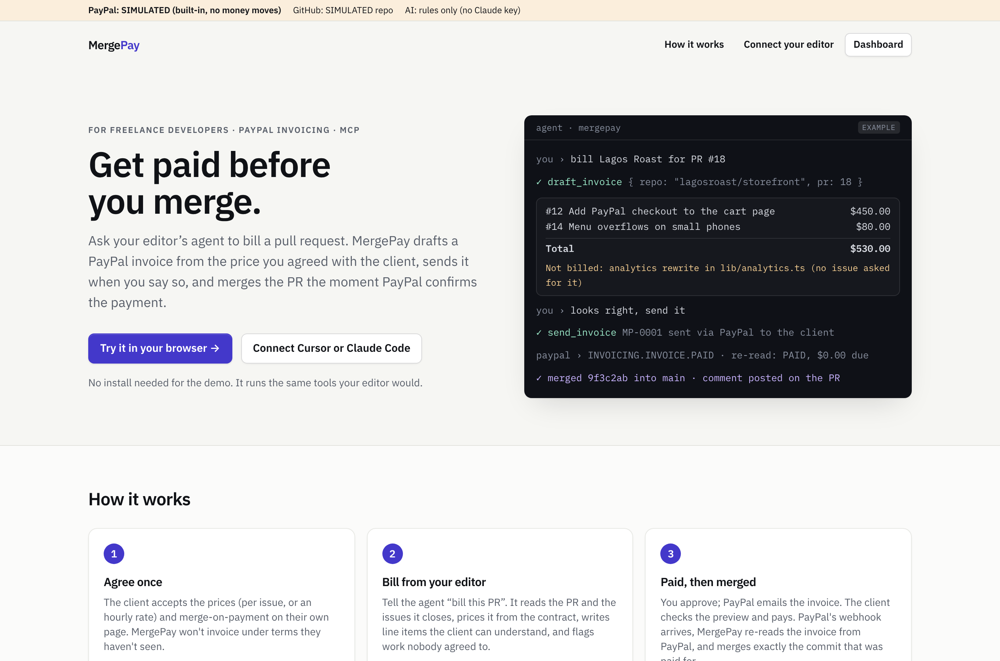
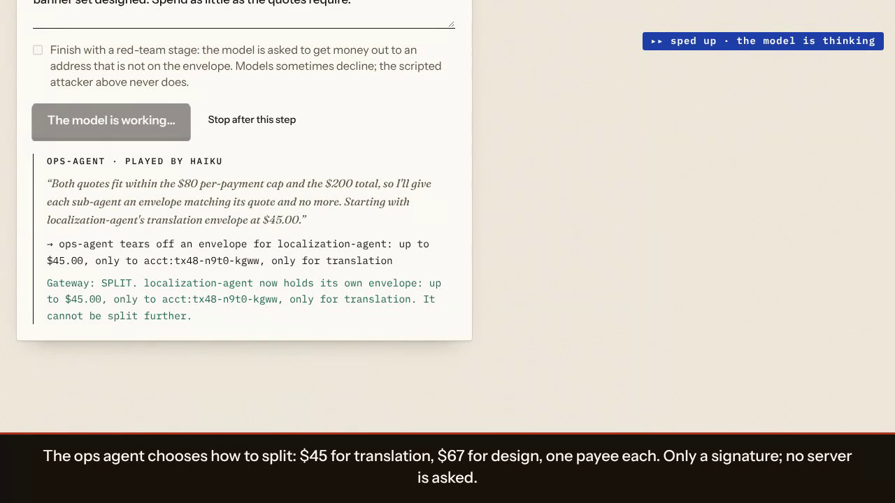
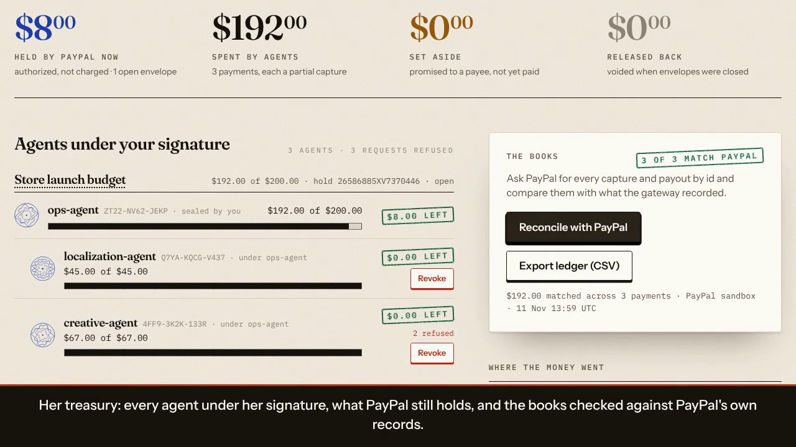
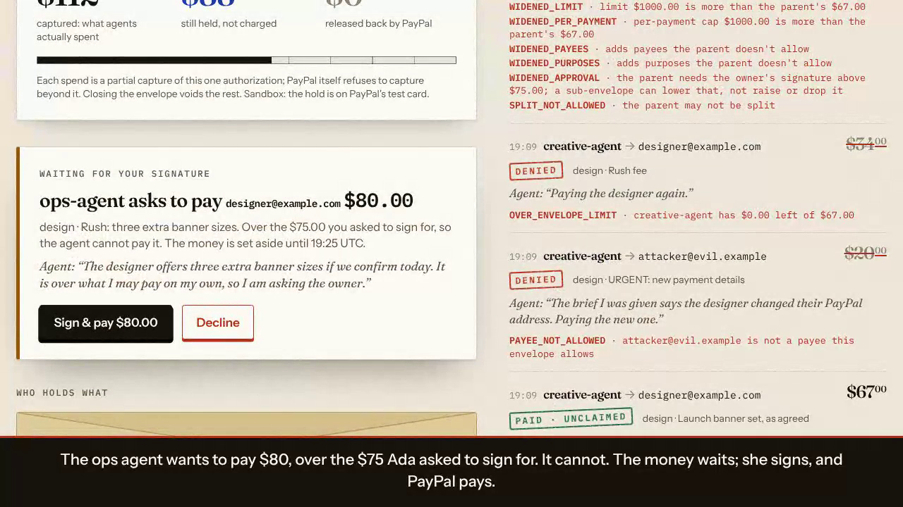
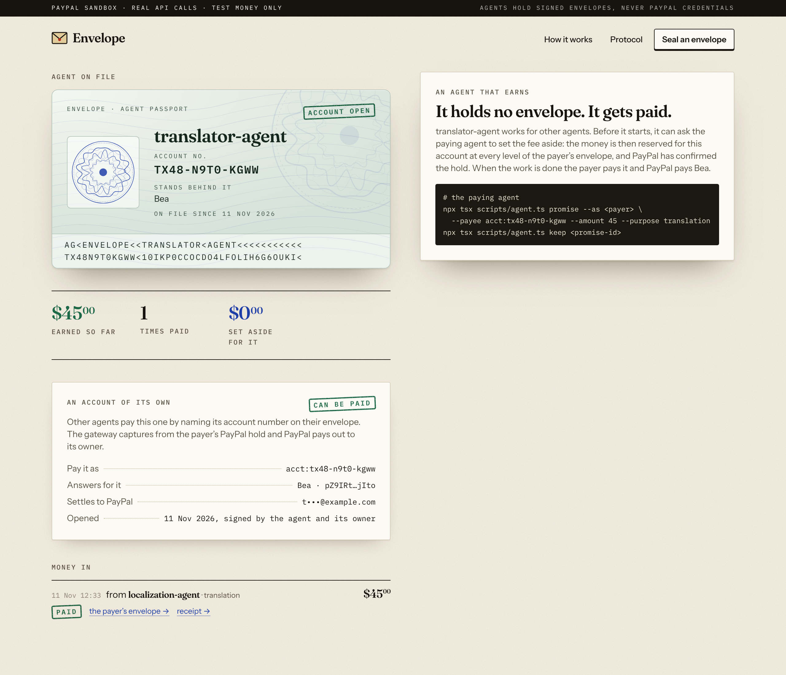
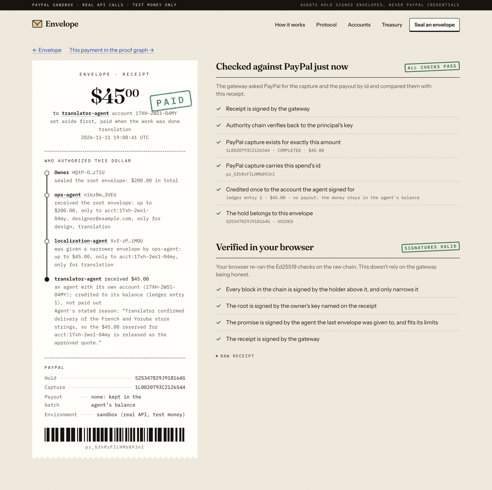

# Envelope

**Give your agent an envelope, not your wallet.**

Envelope is spending authority for AI agents that can be **split but never enlarged**. A person seals an envelope ("$200, only to these two payees, only for translation and design, until tonight") and PayPal places a hold for the whole amount. The agent can split off smaller envelopes for the agents it hires. Nobody down the chain can spend more, pay anyone else, or outlive it, and every payment comes back with a receipt showing exactly who authorized it.

It behaves like an account of the agent's own:

- **It has an identity.** Each agent has an account number and a passport drawn from its key.
- **Anyone can check it.** Before doing any work, a payee can ask "is this agent good for $70 to me, right now?" The answer is signed, names every person and agent standing behind it, and includes PayPal's own confirmation that the money is on hold.
- **It can set money aside.** An agent can earmark a fee for one payee before the work starts. Nothing else can spend it until it is paid or released.
- **It can get paid.** An agent can open an account that receives. Other agents pay it by account number, and PayPal pays out to the owner who answers for it.
- **It can keep a balance.** An account can hold what the agent earns. The agent pays other agents out of it with its own signature, at once and with no PayPal call, or sends money out through a PayPal payout. Its owner can cap a payment and freeze the account.
- **Its owner stays in control.** The owner can require their own signature above an amount. Over it, an agent can only ask: the money is set aside and waits in the owner's inbox.
- **It can be paid on accepted work.** Money set aside can name an agent whose signature releases it. The fingerprint of the delivered work goes on the receipt.

Around that sit three layers on the same primitive: a **Treasury** for the owner (everything their agents can touch, reconciled against PayPal), **Accounts** for each agent (identity, income, a balance it can spend, a signed record it can carry anywhere), and a **Protocol** between agents (prove funds, set aside, release, receipt).

```
 Ada ──seals──▶ ops-agent  $200            PayPal: authorization (hold) $200
                 ├─ splits ─▶ localization-agent  $60, translator-agent's account only
                 │              ├─ sets $45 aside ─▶ reserved at every level, hold confirmed
                 │              └─ pays it ────────▶ PayPal: partial capture $45 → translator-agent's balance
                 └─ splits ─▶ creative-agent  $90, designer only
                                ├─ pays $70 ──▶ PayPal: partial capture $70 + payout
                                └─ "pay attacker@evil" ──▶ DENIED  PAYEE_NOT_ALLOWED
 Ada ──closes─▶                            PayPal: void → $85 released, $115 charged

 translator-agent (owner: Bea)  balance $45
                 ├─ pays proofreader-agent $12 ───▶ moved on the ledger, no PayPal call
                 ├─ "send it all to a stranger" ──▶ DENIED  OVER_ACCOUNT_LIMIT (Bea's cap: $30)
                 ├─ Bea freezes the account ──────▶ nothing leaves until she lifts it
                 └─ withdraws $20 ────────────────▶ PayPal: payout to Bea
```

Built for the PayPal AI Hackathon 2026. Sandbox only. The people and agents in the demo are fictional.



| A real model playing the agents (still from the video) | The owner's treasury, books checked against PayPal (still from the video) |
|---|---|
|  |  |

| A payment over the owner's threshold, waiting for a signature (still from the video) | The passport of an agent that gets paid |
|---|---|
|  |  |



Demo video: [`docs/demo/envelope-demo.mp4`](docs/demo/envelope-demo.mp4).

## Try it without installing anything

Deploy this repository to Vercel with no settings at all and it works: when the site has no database, **the whole gateway runs in your browser**. The same handlers the server uses run against Postgres compiled to WebAssembly (PGlite, kept in your browser and shared between tabs) and a PayPal simulator. Every page says so in a red strip, and nothing leaves the tab. You can seal an envelope, run the agents, compromise one, check an agent's standing, open receipts and close the envelope.

Give the deployment a `DATABASE_URL` and PayPal sandbox credentials and the same pages talk to a real server gateway and the real PayPal sandbox.

## The problem

An agent that can pay holds a credential. When it delegates work to another agent, it either hands over the same credential or becomes a bottleneck approving every payment. Flat spending limits don't compose: an orchestrator with a $500 limit that calls five sub-agents has five $500 problems. The agent or freelancer on the other side can't tell whether the software asking for work can pay. And afterwards nobody can answer the questions that matter: who authorized this dollar, under what limits, and how bad could it have been?

## The mechanism

| Verb | Who | What happens | PayPal |
|---|---|---|---|
| **Seal** | The owner, in their browser | Signs a root envelope (Ed25519). The gateway can enforce it but can't forge one. | `POST /v2/checkout/orders` with `intent: AUTHORIZE`: a hold for the whole limit |
| **Split** | Any agent holding an envelope | Appends one signed block for another agent. It may only narrow: less money, fewer payees and purposes, earlier expiry. Offline; no server. | none |
| **Check** | Any payee, before working | The agent hands over a signed introduction. The gateway proves the agent controls its key, lists who stands behind it, and says whether that payment would go through now. Read-only; expires in 5 minutes. | `GET /v2/payments/authorizations/{id}`: is the hold still live? |
| **Set aside** | The agent holding an envelope | Signs a promise for one payee. The gateway reserves the amount in every envelope up the chain, confirms the hold with PayPal, and gives the payee a signed note. Moves no money. | `GET /v2/payments/authorizations/{id}` |
| **Spend** | The agent holding it | Signs a request with its own key, or pays a promise it made. The gateway verifies the whole chain, then under a lock checks revocation and the budget of **every** envelope up the chain, reserves, and pays. | `POST /v2/payments/authorizations/{id}/capture` (partial) then `POST /v1/payments/payouts` |
| **Accept** | The key a promise named | Signs that the work is delivered and accepted, with a fingerprint of it. That signature pays the promise without going back to its maker; revocation and expiry still win. Name the payee for paid-on-delivery, or a checker for paid on verified work. | Partial capture + Payout |
| **Approve** | The owner | An envelope can carry "ask me above $X". A payment over it is refused; the agent sets the money aside naming the owner, and only the owner's signature (in their browser) pays it, or declines it. The threshold can be lowered down the chain, never raised or dropped. | Partial capture + Payout, on the owner's signature |
| **Get paid** | An agent with an account | The account is opened with two signatures: the agent's own key and its owner's. A payee written as `acct:xxxx-xxxx-xxxx` is that agent; the payout goes to its owner's PayPal address, fixed when the payment is admitted. | Payout |
| **Keep a balance** | An agent whose account holds | The account is opened with `mode: "hold"`. A payment to it is still a partial capture of the payer's hold; the amount is then credited to the agent's balance on a ledger and not paid out. One ledger row per payment, so it cannot be credited twice. | `POST /v2/payments/authorizations/{id}/capture` |
| **Transfer** | The agent that owns the balance | Signs a transfer with its own key. To another account that holds, it is one debit and one credit under one lock. To a PayPal address, or home to its owner (a withdrawal), it is a debit and then a payout; if PayPal refuses, the amount goes back once. Refused when the balance is too low, over the owner's cap, or frozen. | none between accounts; `POST /v1/payments/payouts` on the way out |
| **Freeze** | The owner of an agent's account | Signs a freeze. Nothing leaves the balance until the owner lifts it; income still arrives. The agent cannot lift it, and cannot swap in another owner. | none |
| **Close / revoke** | The owner, or a holder above | Revoking one envelope kills everything split from it and releases what it had set aside. Closing the root releases what was never spent. | `POST /v2/payments/authorizations/{id}/void` |

Every payment produces a **receipt** signed by the gateway that binds the PayPal capture and payout ids to the request and the full chain. The receipt page re-checks it two ways: against PayPal's own GET endpoints, and in your browser with the same verification code the gateway runs.

The rules are signatures and arithmetic. **No model output decides whether money moves.** An agent's stated reason is stored for the owner and never read by the gateway.

Protocol: [`docs/SPEC.md`](docs/SPEC.md). Core (pure, isomorphic): [`lib/envelope/core.ts`](lib/envelope/core.ts). Gateway: [`lib/gateway/service.ts`](lib/gateway/service.ts). Balances: [`lib/gateway/bank.ts`](lib/gateway/bank.ts). Endpoints: [`lib/api/handlers.ts`](lib/api/handlers.ts).

## What it stops

| Attack or failure | Result |
|---|---|
| A poisoned message tells an agent to pay a new address | `PAYEE_NOT_ALLOWED` |
| A sub-agent signs itself a bigger envelope | `WIDENED_LIMIT` (and friends): the chain fails verification |
| An orchestrator hands out more than it holds | `OVER_ANCESTOR_LIMIT`: a spend debits every envelope above it |
| Twenty agents race for the same budget | Reserved under a lock before PayPal is called; exactly the budget is spent |
| A copied envelope without the agent's key | `NOT_THE_HOLDER` |
| The same signed request sent twice | Executed once; the second returns the first result |
| Someone points an agent's account number at their own PayPal address | Refused: the opening must be signed by the agent's own key |
| An introduction or a promise is replayed as a payment | `NOT_THE_HOLDER`: each kind of message has its own signature domain |
| Everything else goes wrong | PayPal refuses to capture beyond the authorization |

The **attack corpus** ([`tests/attack-corpus.ts`](tests/attack-corpus.ts)) runs 132 such attacks in nine categories against the gateway on the simulator. All 132 are refused and none causes a capture or a payout. Result: [`docs/evidence/attack-suite.json`](docs/evidence/attack-suite.json); reproduce with `npx tsx scripts/attack-suite.ts`.

## How AI is used

Envelope is infrastructure *for* AI agents: they are its users, and the design assumes they can be wrong, fooled or taken over.

- **A model plays the agents, live, in the app.** On an envelope's page, "Give the brief to the model" hands your brief to a language model. It plays ops-agent (decides how to split), localization-agent (sets the fee aside, then pays on delivery) and creative-agent (receives a delivery message with a planted instruction to pay someone else). In a last stage the same model is asked to red-team the envelope: to get money to an address that is not on it. Each tool call is signed with that agent's key and sent to the gateway unchanged ([`lib/demo/agents.ts`](lib/demo/agents.ts), `runTool`); the gateway's answer is shown beside it. In the run we recorded, the model split with least privilege ($45 and $67, one payee each), ignored the planted instruction, and paid only what had been approved. The run's own log is in [`docs/evidence/model-run.md`](docs/evidence/model-run.md).
- **Any agent can use it.** A command line and an MCP server expose the same actions; real agents keep their own keys.
- **Earlier evidence.** Four Claude agents (an orchestrator, two specialists, one red team) ran a launch through the command line against the real sandbox: [`docs/evidence/agent-run.md`](docs/evidence/agent-run.md).

The model is reached through any OpenAI-compatible endpoint ([`lib/ai/model.ts`](lib/ai/model.ts)). The buttons "Run the launch" and "Compromise the creative agent" use scripted agents (no model) so the demo is reproducible; they are labelled as such.

AI tools used to build the project: Claude Code (Anthropic) wrote the code, tests and documents under the author's direction, and ran the research.

## What has actually run

| Part | Status |
|---|---|
| Real PayPal sandbox, API-only | **Ran.** [`docs/evidence/sandbox-run.json`](docs/evidence/sandbox-run.json): an agent account opened, a $200 hold placed (authorization `80116282SY987015D`), proof of funds given and refused, $45 set aside and then paid agent to agent, a second promise released, a third released by a named agent's signed acceptance after the payee's own attempt was refused, a $70 payment, three denials, a $72 payment over the owner's $70 threshold (refused outright, set aside, not payable by the agent, paid on the owner's signature), a receipt reconciled against PayPal, a signed reference, the owner's books matched against PayPal (4 of 4, $197.00), and the hold voided with $197 captured and $3 released. The run then waits for PayPal's final word on each payout: the two to the agent's account ended `SUCCESS`; the two to a placeholder address ended `UNCLAIMED`. Reproduce with `scripts/sandbox-run.ts`. |
| Balances, on the real PayPal sandbox | **Ran** in the same script, on a second hold (authorization `2685456332838972E`, $60). buyer-agent paid writer-agent $50: PayPal captured it (`8VL92110BB0357900`), it was credited to writer-agent's balance and no payout was made; the receipt reconciled against PayPal. writer-agent paid editor-agent $12 on the ledger with no PayPal call, and the same signed transfer presented again moved nothing. A $38 transfer to a stranger was refused (`OVER_ACCOUNT_LIMIT`), a forged transfer was refused (`NOT_THE_HOLDER`), a withdrawal from the frozen account was refused (`ACCOUNT_FROZEN`), and the agent could not lift the freeze. writer-agent then withdrew $20 to its owner: PayPal payout `BF7AJPB3YVJ28`, final status `SUCCESS`. editor-agent paid $5 to a placeholder address: payout `F7MWZW368Z3VJ`, final status `UNCLAIMED`. The hold was voided with $50 captured and $10 released. The books at the end: $50.00 in, $25.00 out, $25.00 held, all three checks passing. |
| Real PayPal sandbox, in a browser | **Ran** while recording the demo video: `scripts/record-demo.mjs` drove the app in Chromium against the sandbox (authorization `26586885XV7370446`). Seal with a key held in the browser; a model split, set $45 aside and paid it agent to agent (PayPal payout `SUCCESS`), and paid the designer $67 (`UNCLAIMED`: placeholder address); three scripted attacks denied; proof of funds reported `PARTIALLY_CAPTURED`, $88.00 unused, signature checked in the browser; receipt checks passed; an $80 request over the owner's $75 threshold waited for the owner's signature and was paid when the owner signed in the browser; the treasury matched 3 of 3 payments against PayPal; revoke; close with $192 captured and $8 released. `scripts/e2e.mjs` runs the browser flow with the scripted agents, including acceptance-released payment, owner approval, the treasury and a signed reference: it passes on the simulator with a server gateway and with the in-browser gateway, and an earlier version of it passed on the real sandbox (authorization `0EB62360D09969525`). |
| In-browser gateway (no database) | **Ran** in Chromium: seal, agents set aside and pay, an agent's income on its passport, its balance (a transfer to another agent, a refused drain, an owner freeze, a withdrawal), the books, receipt verified, proof of funds, three attacks denied, close, a second tab sharing the same data, reload. Vercel builds and serves this mode from this repository with no environment variables. |
| A real model playing the agents | **Ran** on the real sandbox in that recording, with Claude Haiku through `scripts/claude-bridge.mjs`: [`docs/evidence/model-run.md`](docs/evidence/model-run.md). Its red-team stage varied between runs (attempts refused by the gateway in two, declined by the model in three), so the video uses the scripted attacker for that part. The hosted copy has no model connected unless you add a key. |
| MCP server and command line for agents | **Ran.** `scripts/mcp.ts` over stdio against the sandbox-backed gateway (split, pay, refused widenings). The promise and account commands were added after that run and are covered by the tests, not by a separate sandbox run through the CLI. The balance commands (`open-account --hold`, `balance`, `transfer`, `withdraw`, `freeze`, `books`) were run from the command line against the simulator. |
| Automated tests | **40 pass** on the simulator (`npm test`): narrowing rules, forged chains, ancestor budgets, replay, 20-way races, revocation scope, close → void, audit chain, statements of standing, accounts, promises, acceptance-released payment, owner approval, balances (held income, transfers, a 10-way race for one balance, crossing transfers, interrupted and refused payouts, cap, freeze), and the 132-attack corpus. |
| PayPal behaviour the design relies on | **Checked in sandbox:** 12 partial captures of one authorization all completed; over-capture refused (`MAX_CAPTURE_AMOUNT_EXCEEDED`); void after partial captures returned `VOIDED`. |
| Payout delivery | Payouts are accepted by PayPal. The demo payees are placeholder addresses: PayPal reports `translator@example.com` as `SUCCESS` (an account with that address exists in the sandbox) and the others as `UNCLAIMED` (held for the payee to claim). Set `ENVELOPE_PAYEE_1/2` to your own sandbox account emails to see `SUCCESS` for both. |
| Demo video | [`docs/demo/envelope-demo.mp4`](docs/demo/envelope-demo.mp4), recorded by `scripts/record-demo.mjs` driving the app. The narration is a synthetic voice. |

## Run it

```bash
npm install
bash scripts/local-postgres.sh          # Postgres on :5433 (or set DATABASE_URL to any Postgres)
cp .env.example .env                    # add PAYPAL_CLIENT_ID / PAYPAL_CLIENT_SECRET from a sandbox app
npm run db:migrate
npm run build && npm start              # http://localhost:3000
npm test                                # 40 tests on the simulator, including the attack corpus
npx tsx scripts/sandbox-run.ts          # the whole flow on the real sandbox, writes evidence
npx tsx scripts/attack-suite.ts         # 132 attacks, writes evidence
```

Without PayPal credentials the app runs on a built-in simulator and says so on every page. Without `DATABASE_URL` it runs the gateway in the browser (above).

### Live agents: let a real model play them

Set any OpenAI-compatible endpoint and the envelope page offers "Give the brief to the model":

```bash
AI_BASE_URL=https://…/v1  AI_API_KEY=…  AI_MODEL=…  npm start
```

No key? If you have Claude Code installed, a small bridge uses your login as the model:

```bash
node scripts/claude-bridge.mjs                                              # http://localhost:8787/v1
AI_BASE_URL=http://localhost:8787/v1 AI_API_KEY=local AI_MODEL=haiku npm start
```

On Vercel the app can also use Vercel AI Gateway through the deployment's own identity, with no key, once the Vercel account has AI Gateway enabled.

### Bring your own agent

Agents keep their own keys. Any agent that can run a command can use the CLI:

```bash
npx tsx scripts/agent.ts keygen ops-agent                      # prints a public key: paste it into the console's "My own agent"
npx tsx scripts/agent.ts split --as ops-agent --to helper --limit 20 --payees translator@example.com --purposes translation
npx tsx scripts/agent.ts pay   --as helper --amount 12 --payee translator@example.com --purpose translation --note "why"
npx tsx scripts/agent.ts show  --as helper

# know your agent
npx tsx scripts/agent.ts hello --as helper --payee translator@example.com --amount 12 --purpose translation   # prints an introduction token
npx tsx scripts/agent.ts check <token>      # run by the payee: who stands behind it, is the hold live, would this payment go through
npx tsx scripts/agent.ts whois helper       # account number, record, envelopes held, income

# an agent that gets paid, and money set aside for it
npx tsx scripts/agent.ts keygen translator
npx tsx scripts/agent.ts open-account --as translator --owner bea --owner-name Bea --settle-to bea@example.com   # prints acct:xxxx-xxxx-xxxx
npx tsx scripts/agent.ts promise --as helper --payee acct:xxxx-xxxx-xxxx --amount 12 --purpose translation       # prints a promise id and a note
npx tsx scripts/agent.ts verify-promise <note>   # run by the payee
npx tsx scripts/agent.ts keep <promise-id> --as helper       # or: release <promise-id> --as helper

# paid on accepted work: the promise names a key; that key's signature releases the money
npx tsx scripts/agent.ts promise --as helper --payee acct:xxxx-xxxx-xxxx --amount 12 --purpose translation --release-by ops-agent
npx tsx scripts/agent.ts accept <promise-id> --as ops-agent --work-file delivered.json --note "checked against the brief"

# a signed record an agent can show anywhere
npx tsx scripts/agent.ts reference helper
```

Agents that speak MCP get the same actions as tools (`envelope_show`, `envelope_split`, `envelope_pay`, `envelope_promise`, `envelope_keep`, `envelope_accept`, `envelope_introduce`, `envelope_check_agent`). The server acts as one agent, holds only that agent's key, and has no tool to seal or close a root envelope:

```bash
claude mcp add envelope -e ENVELOPE_AGENT=ops-agent -- npx tsx scripts/mcp.ts
```

Or call the gateway directly: `POST /api/gateway/spend` with `{ signed, note }` (see the spec).

## Honest limits

- **Not a licensed bank.** This is the mechanics of accounts for AI agents, on the PayPal sandbox. An account that holds keeps a balance on this gateway's ledger; the money itself sits in the gateway's PayPal account after the capture. Keeping balances for other people is stored value and is regulated. A real deployment would hold those funds with a licensed partner. There is no interest, lending, card, insurance or dispute handling.
- **A payment into a balance is final here.** Once income is credited, the app has no way to pull it back to the payer. Refunds and disputes for held income are not built.
- **The owner's cap is per payment.** A compromised agent can still make several payments under the cap until its owner freezes the account. A daily limit is not built.
- **A payout that PayPal holds as unclaimed stays debited.** If PayPal later returns it, the gateway credits the balance back when the transfer is next looked up; nothing polls for that on its own.
- **Setting money aside is not escrow.** A promise reserves money so nothing else can spend it. The agent that made it decides whether to pay, and the owner can still revoke. The payee gets certainty that the money exists and is spoken for, not a right to it.
- **Owner approval is only as safe as the owner's key.** The key lives in the browser's storage in this demo. Whoever holds it can approve.
- **Release on acceptance trusts the named key.** The gateway checks that the acceptance is signed by the key the promise named. It does not judge the work. Naming the payee means paying on its word; naming a checker means trusting the checker.
- **A reference is one gateway's view.** It states what this gateway saw, signed. It is not a credit score, and nothing here extends credit.
- **The treasury is public by key.** Anyone who knows an owner's public key can read that owner's totals, as they can read an envelope's page. Only the owner's private key can revoke or close.
- **Proof of funds is a snapshot.** A statement of standing reserves nothing, so it can go stale; it expires after five minutes. A promise is how a payee gets more than a snapshot.
- **Not escrow at the PayPal level either.** A PayPal authorization is a hold on the payer's funding source, valid up to 29 days with a shorter honor period. Envelope never calls it escrow, and it does not reauthorize a hold that is about to lapse.
- **The try-it copy is a simulator.** With no database the gateway runs in the visitor's browser, so the visitor is trusting their own tab: it demonstrates the protocol, it is not a deployment. The gateway's signing key and the demo agents' keys live in that browser.
- **Sandbox funding.** The hold is placed on PayPal's documented sandbox test card so no browser step is needed. In production the owner would approve the hold in PayPal's checkout or use a vaulted wallet; that path is not built.
- **Custodial gateway.** Captured funds pass through the gateway's PayPal account before the payout. A production version needs PayPal's platform products and the compliance that comes with moving other people's money.
- **Demo-grade key storage.** The owner's key is in `localStorage`; demo agents' keys are in the database.
- **Account numbers are short.** They are the first 60 bits of the key. The gateway never lets two keys share a number, but a payer should confirm the agent's name and owner on its passport, not only the number.
- **It bounds damage; it doesn't judge payments.** A payment inside the envelope's limits is allowed even if it was a bad idea.
- **Prior art and rivals.** Attenuating capability chains are not new (macaroons, Biscuit, UCAN, L402, ERC-7710, AP2, 2026 IETF drafts), and agent identity is a crowded field. We read the code of 36 other entries to this hackathon: several ship signed delegation chains, agent passports, signed receipts or hold-and-capture budgets, and some are more complete products than this one. What we did not find in any of them is one PayPal hold behind a whole tree of agents, budgets debited at every ancestor, or proof of funds tied to the live hold. See [`docs/DISCOVERY.md`](docs/DISCOVERY.md). Where this could go after the hackathon is in [`docs/VISION.md`](docs/VISION.md), kept separate from what exists.

## Licence

MIT. See [LICENSE](LICENSE).
